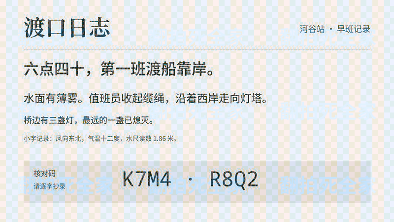

# Anti-copying of video

一个用 Rust 和 GTK 4 编写的 Fedora 实拍对照工具。把显示器设为固定 60 Hz，用手机拍下同一幅原画和两种暗字画面，可以比较现场阅读时的闪动、录像里暗字能读出几个，以及正文或字幕是否仍然清楚。0.4.1 提供一页黑白文字和一段带中文字幕的 10 秒无声短片，实验使用这两份内置素材。

[Fedora 45 x86_64 安装包](https://github.com/shuizhaodemumu/Anti-copying-of-video/releases/download/v0.4.1/photo60-test-0.4.1-1.fc45.x86_64.rpm) · [演示视频（MP4）](https://github.com/shuizhaodemumu/Anti-copying-of-video/releases/download/v0.4.1/photo60-demo-v0.4.1.mp4) · [v0.4.1 发布说明与校验文件](https://github.com/shuizhaodemumu/Anti-copying-of-video/releases/tag/v0.4.1)

## 安装与试拍

在 Fedora 45 x86_64 上下载 RPM，在下载目录执行以下命令。装过 0.4.0 的机器同样可以这样升级。

```sh
sudo dnf install ./photo60-test-0.4.1-1.fc45.x86_64.rpm
photo60-test
```

1. 将显示器设为固定 **60 Hz**。打开程序会先看到原画。手机对准画面后开始录像，保持同一机位和屏幕亮度。
2. 按 **空格** 开启默认的「翻拍暗字」，录几秒后按 **6** 切到「减闪暗字」，最后按 **Esc** 回到原画。文字页有九组暗字，按 3×3 排列。按 **2** 切换到短片，上方中央有一组暗字。切换素材后，需再次按空格开启实验。
3. 在平时的观看距离观察暗字和闪动，再查看手机以 24、30、60 帧录下的片段。分开记录现场和录像里各自能认出几个字。如果手机支持手动曝光，同时记下快门时间，便于复测。

| 操作 | 按键 |
| --- | --- |
| 黑白文字 / 字幕短片 | **1** / **2** |
| 标准色块 / 增强笔画 | **3** / **4** |
| 翻拍暗字 / 减闪暗字 | **5** / **6** |
| 开始实验或切回原画 / 立即回到原画 | **空格** / **Esc** |
| 切换全屏 / 回到片头 | **F11** / **R** |

视频可以通过窗口里的「暂停视频」停在同一帧，方便切换档位对照。程序检测到刷新持续不稳时会回到原画。

## 暗字是怎样形成的

60 Hz 显示器每次刷新约间隔 16.7 毫秒。「翻拍暗字」沿用 0.3 的交替蓝粉配色。「减闪暗字」给同一个像素选取一对亮度接近的颜色，用它们出现的先后顺序编码笔画。对于同一内容帧，两次刷新若被相机等量拍入，减闪档有字与无字的结果逐像素相同。短曝光若偏向某一次刷新，则可能拍到字。



上图取自程序的一次刷新。Release 中的演示视频也使用程序实际渲染的画面。手机实拍时，即使同为 60 帧录像，单帧的曝光时间、曝光开始时刻和相机处理也会改变结果。现场可能察觉色纹或闪动，录像里的正文和字幕也可能保持清晰。

在内置文字页上，按线性亮度计算，默认暗字档相邻两次刷新的像素亮度差均方根为满量程的 **5.63%**，减闪档为 **0.37%**。这两个数值衡量程序输出，观看感受仍需在实际屏幕上比较。

## 从源码运行或打包

在 Fedora 上进入仓库根目录或解压后的源码目录，安装工具后可直接运行。

```sh
sudo dnf install cargo rust gcc gtk4-devel desktop-file-utils python3 rpm-build
cargo run --release --locked
```

运行 `bash packaging/build-rpm.sh` 可在 `dist/` 生成 RPM 和源码包。脚本先按 `Cargo.lock` 获取依赖，再离线编译。测试素材已随源码提供。

## 项目来源和许可证

这个独立实验源于 [Encrypt-your-digital-assets](https://github.com/shuizhaodemumu/Encrypt-your-digital-assets) 的内容保护需求，渲染程序与测试素材在本项目中开发。项目采用与原项目相同的 [MIT 许可证](LICENSE)。关于仓库的 fork 关系、使用的开源库、素材生成工具及各自许可证，见[开源项目与第三方说明](THIRD_PARTY.md)。
